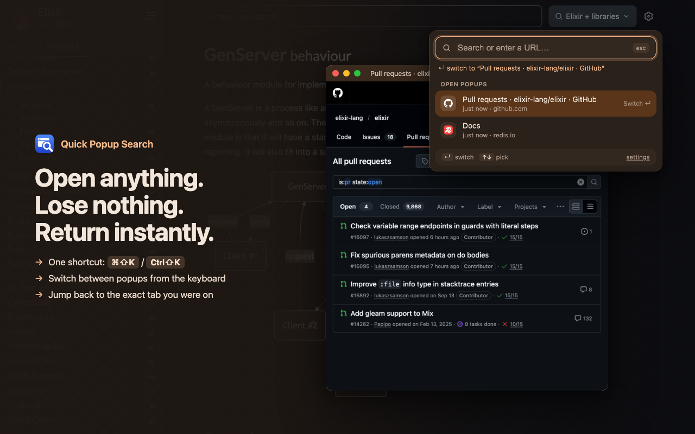

# Quick Popup Search

**Open anything. Lose nothing. Return instantly.**

A Chrome extension for everything that doesn't deserve a new tab. Look something up in a popup window, jump back to exactly the tab you were on, and bring the popup back whenever you need it.



## Features

- **One shortcut** (`⌘⇧K` on Mac, `Ctrl+Shift+K` elsewhere) to search, bring your popup forward, or jump back to your tab
- **Switcher**: open popups, recent searches and recently closed pages in one keyboard-driven list
- **Nothing gets lost**: pages you close or replace stay in "Recently closed"
- **Site shortcuts**: `yt`, `gh`, `so`, `hex`, `w`, `g` + your query
- **Pin** popups you want to keep. **Move** any tab into a popup and back, and the page keeps its place (scroll, forms, video)
- Remembers popup size and position, light and dark mode
- Everything stays on your device

## Install

Not on the Chrome Web Store yet. To install from source:

1. Clone this repo: `git clone https://github.com/chandan7004/QuickPopup.git`
2. Open `chrome://extensions/` and turn on **Developer mode** (top right)
3. Click **Load unpacked** and pick the `QuickPopup` folder
4. A welcome page opens with your shortcuts. If any show "Not set", assign them at `chrome://extensions/shortcuts`

Requires Chrome 127 or newer.

## How it works

1. Press `⌘⇧K`, type `so genserver timeout`, press `↵`. It opens in a popup window.
2. Press `⌘⇧K` again to go back to your tab. The popup stays open.
3. Press it again and the popup comes forward. With 2+ popups you get a switcher.
4. `⌘W` closes the popup and returns you to your tab.

Popups are normal Chrome windows, so they don't stay on top. The shortcut brings them straight back.

## Shortcuts

These work anywhere in Chrome. Change them at `chrome://extensions/shortcuts`.

| Mac | Windows / Linux | Does |
|---|---|---|
| `⌘⇧K` | `Ctrl+Shift+K` | No popup: search box. One popup: bring it forward. 2+ popups: switcher. In a popup: back to your tab |
| `⌥⇧P` | `Alt+Shift+P` | Move the current tab into a popup, or the popup back into a tab |
| `⌥⇧L` | `Alt+Shift+L` | Pin / unpin the popup (pinned popups are never replaced or auto-closed) |
| (not set) | (not set) | Reopen the last closed popup (optional) |
| (not set) | (not set) | Always open the search box (optional) |

### In the search box

| Key | Does |
|---|---|
| `↵` | Open in a new popup (or replace the last one, see Settings) |
| `⌘↵` / `Ctrl+↵` | The other one: replace the last popup / open a new one |
| `⇧↵` / `Shift+↵` | Open in a normal tab |
| `↑` `↓` | Pick from open popups, recent searches, recently closed |
| `esc` | Close the search box |

The line under the search field always shows what `↵` will do before you press it.

### Site shortcuts

| Type | Searches |
|---|---|
| `yt …` | YouTube |
| `gh …` | GitHub |
| `so …` | Stack Overflow |
| `hex …` | Hex packages |
| `w …` | Wikipedia |
| `g …` or anything else | Google |

To search a phrase that starts with one of these words, prefix `g`: `g so many words`. URLs like `github.com/foo`, `localhost:4000` and `10.0.0.5:8080` open directly.

## Settings

Open via **settings** in the search box:

- **Enter opens a search in**: a new popup (default) or the last popup (replaces its page)
- **Auto-close idle popups** after N minutes (off by default; pinned popups are never closed)
- Reset popup size/position, clear history

## Privacy

No servers, no analytics, no tracking, no remote code. Recent searches, recently closed pages, popup position and settings are stored locally in your browser. The extension does not run in Incognito. See [store/PRIVACY.md](store/PRIVACY.md).

| Permission | Why |
|---|---|
| `tabs` | Read the URL and title of popup windows (switcher, Recently closed) and return you to your tab |
| `storage` | Keep the lists and settings above on your device |
| `alarms` | Optional auto-close of idle popups |
| `favicon` | Site icons from Chrome's local icon cache |

## Development

Plain JavaScript, no build step, no dependencies.

| File | What |
|---|---|
| `manifest.json` | Manifest V3 |
| `background.js` | Service worker: popup tracking, shortcuts, return-to-tab, cleanup |
| `popup.html` / `popup.js` | Search box and switcher |
| `options.html` / `options.js` | Settings |
| `welcome.html` / `welcome.js` | First-install page, shows your real shortcuts |
| `theme.css` | Shared colours for settings and welcome pages |
| `make_icons.py` | Regenerates `icons/` with plain Python: `python3 make_icons.py icons` |
| `store/` | Web Store listing text, privacy policy, screenshots (not part of the extension package) |

After editing, click ↻ reload on the extension card in `chrome://extensions/`. Shortcut or permission changes need a remove + **Load unpacked**.

Packaging for the Web Store (excludes dev files):

```bash
zip -r ../QuickPopup.zip . -x 'store/*' 'make_icons.py' 'README.md' '.git*' '*.DS_Store'
```
